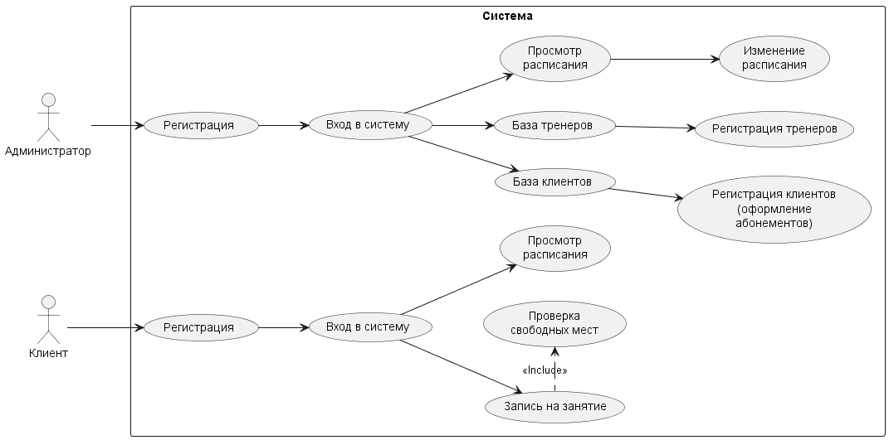
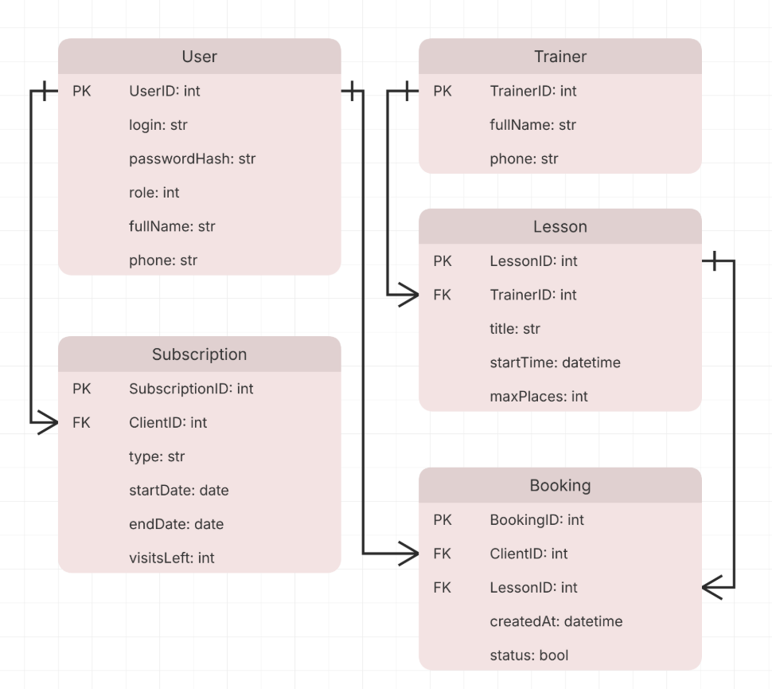

# Fitness Club Tracker

Учебный проект: система учёта тренеров и занятий в фитнес-клубе.


Консольная программа на C++ с базой данных SQLite, выполненная в рамках лабораторных работ №1–5.

## Содержание

- [Описание проекта](#описание-проекта)
- [Пользователи и роли](#пользователи-и-роли)
- [Основные функции](#основные-функции)
- [Архитектура](#архитектура)
- [Use Case диаграмма](#use-case-диаграмма)
- [База данных](#база-данных)
- [Экспорт данных](#экспорт-данных)
- [Структура репозитория](#структура-репозитория)
- [Сборка и запуск](#сборка-и-запуск)
- [Тестовые пользователи](#тестовые-пользователи)

## Описание проекта

Предметная область — деятельность фитнес-клуба в части организации спортивных занятий. В клубе работают тренеры со своим графиком, администрация составляет расписание занятий (тренер, время, вместимость), а клиенты с действующим абонементом записываются на занятия. Система учитывает тренеров, расписание, клиентов с их абонементами и записи на занятия.

**Цели системы:**

- централизованно хранить сведения о тренерах, расписании, клиентах, абонементах и записях;
- исключить конфликты в расписании (один тренер не ведёт два занятия одновременно, число записавшихся не превышает максимум);
- автоматизировать запись на занятия с проверкой свободных мест и действия абонемента;
- дать администрации общую картину: тренеры, клиенты, расписание.

## Пользователи и роли

| Роль | Возможности |
|---|---|
| **Администратор** | ведёт справочник тренеров, составляет расписание, регистрирует клиентов и абонементы, выгружает расписание в файлы — полный доступ к данным |
| **Клиент** | просматривает общее расписание, записывается на занятия, смотрит свои записи и абонементы |

Тренеры в систему не входят: их добавляет администратор и прикрепляет к занятиям. Администраторов может быть несколько — при регистрации выбирается роль (клиент или администратор).

## Основные функции

1. Вход в систему и регистрация клиентов и администраторов.
2. Добавление тренеров (ФИО, телефон) и прикрепление их к занятиям.
3. Составление расписания (добавление, изменение, удаление занятий) с проверкой отсутствия накладок у тренера.
4. Регистрация клиентов и оформление абонементов (срок действия, число посещений).
5. Запись клиента на занятие с проверкой: абонемент активен, есть свободные места, клиент ещё не записан.
6. Просмотр расписания и списка записавшихся на занятие.
7. Экспорт расписания в форматы JSON, CSV, XML и YAML.

## Архитектура

Классическая трёхуровневая архитектура:

- **Presentation Layer** (`src/ui`) — консольное меню: показ информации, приём команд;
- **Business Logic Layer** (`src/services`) — логика программы на C++: проверка свободных мест и действия абонемента, контроль накладок в расписании, проверка вводимых данных;
- **Data Layer** (`src/repositories`, `src/database`) — работа с базой данных SQLite (таблицы User, Trainer, Lesson, Subscription, Booking).

Модели данных (структуры для каждой таблицы) находятся в `src/models`.

## Use Case диаграмма

Диаграмма построена в PlantUML, исходный файл — [`docs/diagrams/usecase.puml`](docs/diagrams/usecase.puml).



Два актёра — **Администратор** и **Клиент**. «Просмотр расписания» доступен обоим. Связь `«include»` показывает, что запись на занятие всегда включает проверку свободных мест.

## База данных

СУБД — **SQLite**. Таблицы, связи и тестовые данные описаны в [`database/database.sql`](database/database.sql). Если файла `database/database.db` нет, программа создаёт его из этого скрипта автоматически.

| Таблица | Назначение |
|---|---|
| `User` | пользователи системы: `role` 0 — клиент, 1 — администратор |
| `Trainer` | тренеры (ФИО, телефон) |
| `Lesson` | занятия в расписании, у каждого один тренер (`TrainerID`) |
| `Subscription` | абонементы клиентов: срок действия и остаток посещений |
| `Booking` | записи клиентов на занятия: `status` 0 — отменена, 1 — активна |

Связи: тренер 1:N занятия, клиент 1:N абонементы, клиенты и занятия — M:N через таблицу `Booking`.



## Экспорт данных

Администратор может выгрузить расписание (пункт меню «Экспорт»). Программа создаёт папку `out` и четыре файла:

- [`out/data.json`](out/data.json) — JSON;
- [`out/data.csv`](out/data.csv) — CSV;
- [`out/data.xml`](out/data.xml) — XML;
- [`out/data.yaml`](out/data.yaml) — YAML.

Для каждого занятия выгружается вложенный объект `trainer` (тренер) и список `clients` (записавшиеся клиенты). Структура задаётся названиями столбцов в SQL-запросе (`trainer.fullName`, `clients[]`), поэтому код экспорта подходит и для других таблиц.

## Структура репозитория

```
fitness-club-tracker/
├── .git/
├── .gitignore
├── README.md
├── build.bat               # сборка программы
├── database/
│   ├── database.sql        # таблицы и тестовые данные
│   ├── database.db         # база данных SQLite
│   └── database.png        # ER-диаграмма
├── docs/
│   └── diagrams/
│       ├── usecase.puml    # исходник диаграммы (PlantUML)
│       └── usecase.png     # сгенерированное изображение
├── out/                    # результат экспорта (JSON, CSV, XML, YAML)
├── src/
│   ├── main.cpp            # точка входа в программу
│   ├── database/           # подключение к SQLite
│   ├── models/             # модели данных
│   ├── repositories/       # SQL-запросы (CRUD)
│   ├── services/           # бизнес-логика
│   ├── ui/                 # консольное меню
│   └── export/             # экспорт в JSON, CSV, XML, YAML
└── third_party/
    └── sqlite/             # библиотека SQLite (sqlite3.c, sqlite3.h)
```

## Сборка и запуск

Требуется компилятор C++17 (g++, например MSYS2 / MinGW-w64). Сборка и запуск из корня проекта:

```bash
build.bat
build\fitness_club.exe
```

## Тестовые пользователи

| Логин | Пароль | Роль |
|---|---|---|
| `admin` | `admin` | Администратор |
| `ivanov` | `1` | Клиент |
| `petrova` | `2` | Клиент |
